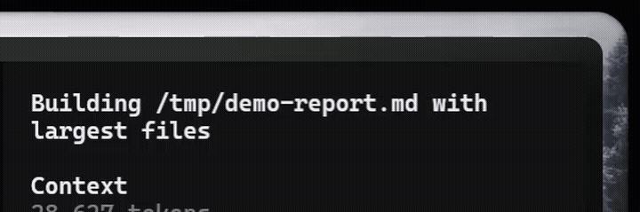

# opencode-desktop-notify

Desktop notifications for [opencode](https://opencode.ai). Built for [Caelestia shell](https://github.com/caelestia-dots/shell) users, but works on any Wayland/X11 setup with `notify-send` — including niri with [Noctalia](https://github.com/noctalia-dev/noctalia-shell), Hyprland, and sway.

> Formerly `opencode-caelestia-notify` — same plugin, now desktop-agnostic.

Get a popup the moment opencode finishes a task, hits an error, needs a permission approval, or asks you a question. No more staring at the terminal.



## Features

| Event                                                       | Notification                                   |
| ----------------------------------------------------------- | ---------------------------------------------- |
| `session.idle`                                              | "ready" popup + session title (normal urgency) |
| `session.execution.failed` (V1: `session.error`)             | error detail in body (critical)                |
| `permission.asked` (V1: `permission.updated`)                | "waiting for you" (critical, deduped)          |
| `form.created` (V1: `question.asked`)                       | "question for you" (critical)                  |

- Session title is fetched through the opencode client and included in every popup, so multi-session users know which one is talking
- Duplicate-event dedupe (opencode can emit repeated idle events)
- Optional focus suppression: skips "ready" popups while your terminal is focused; errors/permissions/questions always come through
  - Focus is read from `hyprctl` (Caelestia/Hyprland), then `niri msg`, then `swaymsg`
  - Terminal IDs include `caelestia-term`, Ghostty, Kitty, Alacritty, foot, WezTerm, and more
- Uses your existing notification daemon styling and sounds (Caelestia, Noctalia, swaync, mako, dunst — whatever owns `org.freedesktop.Notifications`), no extra sound setup
- One file supports both OpenCode v1 and v2; zero npm dependencies

## Requirements

- [opencode](https://opencode.ai) (v1 or v2)
- A working `notify-send` (libnotify) + notification daemon. Caelestia and Noctalia ship one out of the box; other users can install `swaync`, `mako`, or `dunst`

Test yours first:

```sh
notify-send -u low -i dialog-information-symbolic 'Test notification'
```

## Install

```sh
mkdir -p ~/.config/opencode/plugins
curl -fsSL https://raw.githubusercontent.com/Shanu-Kumawat/opencode-desktop-notify/main/notify.js \
  -o ~/.config/opencode/plugins/notify.js
```

OpenCode v2 auto-loads and hot-reloads global plugins. For OpenCode v1, restart any running sessions.

## Configuration

Edit the constants at the top of `notify.js`:

```js
const APP = "opencode"
const USE_APP_ICON = true                     // embed + install the opencode logo
const SUPPRESS_WHEN_TERMINAL_FOCUSED = true   // skip "ready" popups when terminal focused
const TERMINAL_IDS = ["caelestia-term", "kitty", "foot", ...] // focused window IDs treated as terminals
```

Environment variable overrides:

```sh
OPENCODE_NOTIFY_NO_SUPPRESS=1        # disable focus suppression for one run
OPENCODE_NOTIFY_DEBUG=/tmp/log.txt   # log every notification/suppression to a file
```

## Troubleshooting

- **No popups**: run the test command above; if it fails, your notification daemon isn't running (`systemctl --user status swaync`, or check Noctalia is running)
- **Popups only when terminal unfocused**: that's the suppression feature; add your terminal's class/app_id to `TERMINAL_IDS` or set `SUPPRESS_WHEN_TERMINAL_FOCUSED = false`
- **Plugin not loading**: check `~/.config/opencode/plugins/` path. On v2, run `opencode api get /api/plugin` and look for `id: "opencode-notify"` with `status: "active"`. On v1, restart the session.

## License

[MIT](LICENSE)

The opencode logo is © [Anomaly](https://anoma.ly) / [opencode.ai](https://opencode.ai), used here solely to identify notifications from the opencode CLI.
